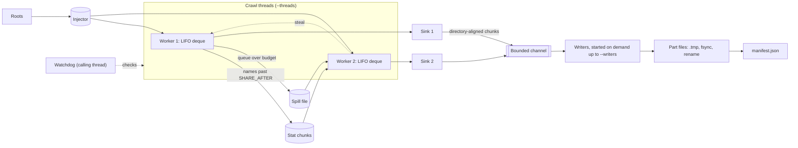

# Architecture

This document explains how fs-inventory 0.4.0 is built and why. It is for engineers who maintain or extend the code, and for administrators who want to know what the tool does to their file systems before they run it. For how to use it, see the [user guide](user-guide.md). For every column, see the [schema reference](schema.md). [PLAN.md](../PLAN.md) holds the original design and the roadmap; this document describes the code as it is.

## 1. Overview

fs-inventory is a Cargo workspace with two crates:

| Crate | Contents |
|---|---|
| `fs-inventory-core` (library) | The parallel walker, the platform backends, file-name analysis, and the record model. It knows nothing about output formats. |
| `fs-inventory` (binary) | The command-line interface, the output pipeline (CSV, JSON Lines, Parquet), the manifest, and the `rollup`, `verify`, `schema`, and `probe` commands. |

The boundary between them is the `Sink` trait in `crates/fs-inventory-core/src/walker.rs`. The walker calls `entry`, `error`, `end_dir`, and `finish` on one sink per crawl thread. Everything after that, including buffering, encoding, compression, and files, belongs to the binary.

A scan flows like this:

1. `scan` (`crates/fs-inventory/src/scan.rs`) validates options, creates an empty output directory, writes a manifest with status `running`, starts the output pipeline, and calls `walker::walk`.
2. Crawl threads read directories and hand rows to their sinks.
3. Sinks buffer rows and send them, a directory at a time, through a bounded channel to writer threads.
4. Writers encode and compress rows into part files and commit each one atomically.
5. When the walk returns, `scan` waits for the writers, writes the final manifest with the status, totals, and list of parts, and syncs the directory.

Nothing in the crawl modifies the file system being scanned. The only files written are in the output directory.

## 2. The crawl

The walker is in `crates/fs-inventory-core/src/walker.rs`.

### 2.1 Directory tasks and IDs

A directory waiting to be read is a `DirTask`: its full path as bytes, `dir_id`, `parent_id`, depth, the stat its parent already took, and whether it is a mount point. The calling thread stats each root and pushes root directories onto a global `Injector`. A root that is a file gets a row immediately. A root that can't be stat'ed, such as a missing one, gets a row in the errors table.

`dir_id` comes from one shared atomic counter, starting at 1. A directory gets its ID when its parent lists it, before it is queued. Every directory has an ID, including ones the crawl doesn't enter (mount points, directories at `--max-depth`, revisits). Roots have `parent_id` 0. IDs are dense, which `rollup` relies on to index directories in a flat array.

### 2.2 Work stealing

Each crawl thread owns a LIFO deque from `crossbeam-deque`. It pushes the subdirectories it finds onto its own deque and pops the newest first, so each thread walks depth-first and its queue stays small. Each worker's loop, in order:

1. Pop from its own deque.
2. Help stat a batch from a huge directory (section 2.4).
3. Steal: first a batch from the global injector, then from peers one at a time, starting with the next worker so stealing spreads evenly. Thieves take from the old end of a peer's deque, where the directories nearest the root are: the biggest remaining pieces of work. The loop stops at the first successful steal, so a stolen task is never dropped.
4. Read back a directory from the spill file (section 6.3).
5. If every directory is done, exit. Otherwise back off: spin, yield, then sleep 200 µs.

`Counters::pending` counts directories queued or being read. The walk is finished when `pending` drops to the number of directories abandoned by the watchdog (usually zero).

### 2.3 Reading one directory

`WorkerState::process` opens the directory and checks that the open directory's device and inode match the stat taken when it was listed. If they don't, the directory was replaced during the scan, and it is recorded as a `verify` error instead of being read. A directory that vanished between listing and opening counts as vanished, not as an error.

`read_entries` reads names in batches from the backend. For each name, `stat_names` takes a stat relative to the open directory, and `child` decides what to do:

- **Snapshot directories** (`.snapshot`, `~snapshot`, `.snapshots`, `.zfs`; `SNAPSHOT_DIRS`) and the scan's own output directory (matched by device and inode) are skipped entirely, with no row, unless `--include-snapshots` is set.
- **Excluded paths** (`--exclude`, `--exclude-from`) are skipped entirely, with no row, and excluded directories are not entered. A glob without `/` matches a name at any depth; it is compiled as `**/GLOB`.
- **Other entries** are added to the directory's totals.
  - Files, symlinks, and other non-directories get a row at once.
  - Subdirectories are queued if they are within `--max-depth` and on the same device, or `--cross-mounts` is set. Otherwise they get a row now, with no totals.
  - With `--detect-cycles`, a subdirectory whose `(dev, ino)` was already entered gets a row with the error `revisit` and is not queued. The visited set is split into 64 locked shards to keep contention low.

Symlinks are never followed. The only exception is a scan root: a symlink given as a root is followed, because the user named it.

After the last name, the directory's own row is written. Its row comes after the rows of its children, so it can carry the totals of its immediate children: entry count, files, subdirectories, bytes, and allocated bytes. A directory that couldn't be opened or verified gets a row with `error` set and no totals. A directory where reading failed partway gets an error and totals for what was read.

### 2.4 Huge directories

A single directory can hold millions of entries. Reading names (`getdents64`) is one sequential stream, but the stat calls don't have to be.

After a worker has read `SHARE_AFTER` (10,000) names from one directory, it stops statting the rest itself. Each further batch of names goes into a global `StatChunk` injector, together with an `Arc<SharedDir>`. The `SharedDir` holds the open directory, a mutex for totals, and a count of outstanding batches. Idle workers check this injector before they try to steal directories (step 2 above). They stat a batch relative to the shared open directory, emit its rows into their own sinks, and merge their totals.

The reading worker keeps reading names. When it reaches the end, it helps with outstanding batches, its own or any other directory's, until all of its directory's batches are done. Then it merges the shared totals and writes the directory row. A drop guard (`Finished`) decrements the outstanding count even if a batch panics, so the reading worker never waits forever.

### 2.5 Containing failures

Every entry is processed inside `catch_unwind`. A bug triggered by one strange entry costs that entry: it is recorded as an `internal` error, and the rest of the directory is still read. The same applies to each directory as a whole. Stat failures are recorded in the errors table, and the crawl continues. Entries that disappear between being listed and being stat'ed are counted as vanished, not as errors, because live file systems churn.

### 2.6 Stopping

The walk stops early when its `stop` flag is set. That happens on the first SIGINT or SIGTERM, or when output fails (section 5.6). Workers check the flag between directories, so each finishes the directory it is reading. The directories still queued are left unread, and the walk reports itself incomplete. As they exit, workers move their queued directories to the global injector, so the walk can return them as the state a resume continues from (section 6.5).

## 3. Platform backends

The walker only uses the `Backend` trait (`crates/fs-inventory-core/src/backend/mod.rs`):

| Method | Purpose |
|---|---|
| `stat_root` | Stat a root, following a symlink at the root itself |
| `open_dir` | Open a directory by full path, following a final symlink only for roots |
| `dir_stat` | Stat an open directory (for the replaced-directory check) |
| `read_names` | Append the next batch of names, never `.` or `..` |
| `stat_at` | Stat a name relative to an open directory, without following symlinks or triggering automounts |

An open directory (`Backend::Dir`) must be shareable across threads, because huge directories are stat'ed by several workers at once. Tests wrap the native backend to inject failures, trace calls, or hang (section 9).

### 3.1 Linux

`crates/fs-inventory-core/src/backend/linux.rs`:

- **Listing:** `getdents64` through rustix's `RawDir`, into a 256 KiB buffer per worker. Each `read_names` call issues exactly one `getdents64`.
- **Metadata:** `statx` relative to the open directory, with `AT_SYMLINK_NOFOLLOW` and `AT_NO_AUTOMOUNT`. The field mask comes from `--fields`. Fields left out aren't requested at all, which on Lustre avoids a round trip to the storage servers for sizes. `--statx-dont-sync` adds `AT_STATX_DONT_SYNC`, which accepts cached attributes on network file systems.
- **Kernels before 4.11** have no `statx`. The first `ENOSYS` is remembered in an atomic flag, and every later stat calls `fstatat` directly, with the same flags except `AT_STATX_DONT_SYNC`. `btime` is then null.
- **Access times:** directories are opened with `O_NOATIME` where permitted, so reading them doesn't update their access times. `O_NOATIME` needs ownership or `CAP_FOWNER`; after the first `EPERM` the flag is dropped for the rest of the scan.
- **System calls:** rustix makes Linux system calls directly, not through the C library. The static musl build and a glibc build therefore make the same calls.

### 3.2 macOS and other POSIX systems

`crates/fs-inventory-core/src/backend/posix.rs` uses `readdir` (rustix `Dir`), 4,096 names per call, and `fstatat` relative to the open directory. Birth time comes from `st_birthtime` on Apple platforms and the BSDs. Every metadata field is read regardless of `--fields`; the output still writes skipped fields as null.

### 3.3 Long paths

Paths can exceed `PATH_MAX` (4,096 bytes), and `open` then fails with `ENAMETOOLONG`. `DirOpener` retries by walking the path one component at a time with `openat`, applying the caller's flags only to the final component. Paths are stored in full regardless of length, and `name_flags` marks them with `long_path`.

## 4. File names

On Unix, a file name is any sequence of bytes except `/` and NUL. Names from legacy systems are often Latin-1 or Shift-JIS rather than UTF-8, and some contain newlines or other control characters. fs-inventory keeps names as bytes from `getdents64` to the output boundary, and converts them to text only when writing a row (`crates/fs-inventory-core/src/names.rs`).

- **`to_text`** returns valid UTF-8 unchanged. Bytes that aren't valid UTF-8 become `\xNN` escapes. For CSV, control characters are also escaped (`\t`, `\n`, `\r`, `\xNN`), so every record stays on one line; `--csv-raw-controls` turns that off. JSON Lines and Parquet keep control characters, because those formats escape or store them safely.
- **Exact bytes:** `to_text` returns a borrowed string exactly when the text equals the original bytes. When it doesn't, the writer also stores the exact bytes: `path_raw` (binary) in Parquet, `path_b64` (base64) in CSV and JSON Lines. `--raw-paths always` stores them for every row. Roots and stalled paths in the manifest use the same `path`/`path_b64` pair.
- **`name_flags`** is a bitmask of properties that cause trouble in analytics or migrations: invalid UTF-8, C0 and C1 control characters, DEL, bidirectional controls, names not in Unicode NFC, leading or trailing spaces, a leading dash, a trailing dot, characters or device names Windows reserves, names over 255 bytes, and paths of 4,096 bytes or more. The bit values are listed in the [schema reference](schema.md#name-flags).
- **Extensions** are the bytes after the last dot, with ASCII letters lowercased. Dotfiles, names ending in a dot, and extensions over 32 bytes have none.

## 5. Output pipeline

The pipeline is in `crates/fs-inventory/src/output/`.

### 5.1 Sinks

Each crawl thread gets a `RowSink`. A sink buffers rows as text (CSV or JSON Lines) or in Arrow column builders (Parquet). The expensive Parquet encoding and compression happen later, in the writers. The buffer lives in a `SinkState` behind an `Arc<Mutex<_>>`, which the output also keeps so it can salvage a stuck worker's rows (section 6.2). Each sink lock is uncontended in normal operation.

Sinks send rows at directory boundaries. At each `end_dir`, the sink records a mark: the rows up to here belong to finished directories. It sends its buffer once the buffer passes its share of the sink budget:

| Setting | Value |
|---|---|
| Sink budget for all threads together | `SINK_BUDGET_BYTES`, 64 MiB (less with `--max-memory`) |
| One thread's share | budget ÷ crawl threads, clamped to 64 KiB through 1 MiB |
| Mid-directory send | when one directory's rows reach 4 × the share (`MAX_BUFFER_FACTOR`) |
| Error rows | sent at a directory boundary once 256 are buffered |

So memory for buffered rows doesn't grow with the thread count, and a directory of millions of entries can't hold unbounded memory.

### 5.2 Writers

Sinks send chunks through a bounded crossbeam channel that holds `BACKLOG_PER_WRITER` (4) chunks per allowed writer. When the channel is full, sinks block, and the crawl slows to the speed of the disk instead of growing memory.

Writers start on demand. The output starts with one writer. When a sink sends a chunk and finds at least 4 chunks queued per running writer, it starts another, up to `--writers` (default: the CPU count, at most 8). The last rows each sink sends when it finishes don't start writers: all the sinks finish at about the same moment, so their final chunks arrive together even when the writers are keeping up. A small scan therefore writes one part file per table, and a large one uses as many writers as compression needs.

Each writer has its own part files for each table, named `part-wNN-SSSSSS` (writer, then sequence). Output files therefore scale with `--writers`, not `--threads`.

### 5.3 Part files and the commit protocol

A writer rolls to a new part at `--part-max-bytes` (default 1 GiB, measured after compression) or `--part-max-rows`. A chunk is never split, so its rows always land in one part. Each part is committed in three steps (`crates/fs-inventory/src/output/parts.rs` and `parquet.rs`):

1. Write `NAME.tmp`; for Parquet, the footer is written last.
2. `fsync` the file.
3. Rename it to `NAME`.

A finished part is therefore always complete and valid, and a crash leaves only `.tmp` files behind. Zstd text parts include a content checksum. At the end of the scan, the manifest is written the same way (`manifest.json.tmp`, fsync, rename), and the scan directory itself is fsynced so the renames are durable.

### 5.4 Parquet settings

`crates/fs-inventory/src/output/parquet.rs` configures the writer:

- **Compression:** zstd level 3 by default; `--compression` also accepts other zstd or gzip levels, Snappy, LZ4, or none.
- **Row groups:** up to `--row-group-rows` (default 1,048,576) rows. An in-progress row group is also capped in bytes: `MAX_ROW_GROUP_BYTES` (128 MiB) per writer by default, and less under `--max-memory`, but never under 8 MiB.
- **Statistics:** page-level, so DuckDB can skip data by `mtime`, `size`, or `uid`.
- **Encodings,** chosen by measurement on 1.24 million real entries:
  - `path` uses `DELTA_BYTE_ARRAY`, storing each path as a suffix of the previous one, which cut it from 7.9 to 5.0 bytes per entry.
  - `ino` uses `DELTA_BINARY_PACKED`.
  - Dictionary encoding is off for high-cardinality columns (`path`, `name`, `path_raw`, `ino`, `dir_id`, and the timestamps), where it made files larger and slower.
- **Footer metadata:** every file records `fs_inventory.schema_version`, `tool_version`, `scan_id`, `host`, and `roots`, so a part file identifies its scan even when separated from the manifest.

One schema definition (`output/schema.rs`) drives the Arrow schema, the CSV and JSON Lines columns, `fs-inventory schema`, and `docs/schema.md`. Integer columns are signed, so scans load into databases without unsigned types. Only `dev`, `ino`, and `rdev` are unsigned, because they are opaque 64-bit identifiers whose top bit can be set. A value above the signed maximum is capped, not wrapped. `--columns` selects a subset of entry columns in any format.

### 5.5 Text formats and stdout

CSV and JSON Lines rows are encoded in the sinks (`output/encode.rs`) and written by the same rolling part writers, optionally through zstd or gzip. Timestamps are ISO-8601 UTC text by default, or epoch seconds with `--time-format epoch`, in microseconds or nanoseconds (`--time-unit`). A timestamp a format can't represent is clamped, and `time_flags` records which ones were clamped.

With `-o -`, there is one writer, entry rows stream to stdout as CSV or JSON Lines, and error rows go to stderr. No manifest is written. A closed pipe, such as `| head`, ends the scan cleanly with exit code 3.

### 5.6 Failures and the manifest

If a writer fails, for example because the disk is full, it records the error, sets the walk's `stop` flag, and drains the channel so no sink blocks forever. The scan ends with status `failed` and exit code 4. Parts committed before the failure are listed and valid.

The manifest (`output/manifest.rs`) records:
- the scan ID, a time-ordered UUIDv7;
- the tool and schema versions, host, roots, format, compression, columns, and the options that shape the output;
- start and finish times;
- totals: entries by kind, directories read, bytes, errors, vanished, revisits, spilled;
- errors grouped by operation and errno;
- stalled directories;
- each resume, if any (`resumes`);
- every committed part, with its row count and size.

Its `status` is one of:

| Status | Meaning |
|---|---|
| `running` | Written at the start. Still present after a crash, when `resume` continues from the last checkpoint. |
| `complete` | Every directory was visited. Per-entry errors may still have occurred. |
| `interrupted` | Stopped by a signal or a closed stdout. Queued directories were not read; `resume` reads them. |
| `incomplete` | Finished, except directories given up on after `--stall-timeout` (listed in `stalled`). |
| `failed` | Output couldn't be written. The parts listed are valid but partial. |

Exit codes follow from the status: 0 for complete without errors, 1 for complete with errors, 2 for invalid usage, 3 for interrupted or incomplete, and 4 for fatal (`crates/fs-inventory/src/exit.rs`).

## 6. Robustness

### 6.1 Errors and vanished entries

Per-entry failures go to the errors table, with the path, the failed operation (`open`, `readdir`, `stat`, `verify`, `stall`, or `internal`), the errno and its name, and a message. Directories that failed also carry the error in their own `entries` row. A revisit (`--detect-cycles`) isn't a failure: it appears only in the directory's own row, as `revisit: ...` in `error`, and in the manifest's `revisits` count. Workers keep their counts locally and add them to the shared counters once per directory. The manifest summarizes errors by operation and errno.

### 6.2 The stall watchdog

A thread stuck in a system call to a hung NFS server can't be interrupted. The walker can't free that thread, but it can stop waiting for it.

The calling thread of `walk` is the watchdog. It wakes every `WATCHDOG_TICK` (250 ms), or as soon as a worker exits. Each worker has a `WorkerStatus` with two fields:
- a progress word: 0 while idle, otherwise the time of its last progress in milliseconds since the walk started;
- the directory or batch it is working on.

Workers update the progress word after every stat and every batch of names, and before writing a directory's row. Each update is a compare-and-swap that fails if the watchdog has stored `ABANDONED` (`u64::MAX`). A worker that sees that knows to stop and write nothing more.

Workers don't read the system clock for these updates. The watchdog refreshes a coarse clock on each tick, kept in its own cache line, and workers read it from memory. Reading the real clock per entry would cost a system call each time in static musl builds, about 2 µs in measurements. That halved the crawl rate.

On each tick, the watchdog:

1. Lists workers with no progress for 60 s (`STALL_REPORT`). Progress output shows them as stalled.
2. With `--stall-timeout`, abandons any worker with no progress for that long. It does this only if the progress word still holds the value it read, so a worker that just moved can't be abandoned. For an abandoned directory, the watchdog:
   - writes a `stall` error;
   - writes the directory's row with that error;
   - counts it as abandoned, so the walk can finish without it;
   - lists it in the result.

   The other workers finish everything else. The stuck thread is detached, and if it ever returns, it writes nothing.

The abandoned worker's sink was never finished, so `Output::finish` salvages it. It waits up to 5 s (`SALVAGE_WAIT`) for the sink's lock, keeps the rows up to the last directory mark, drops the rows of the directory the worker was stuck in, and sends the rest to the writers. Rows the sink had already sent mid-directory, which only happens in directories large enough to trigger a mid-directory send (section 5.1), can't be recalled. The scan ends with status `incomplete` and exit code 3 instead of hanging.

If a batch of a huge directory hangs, the reading worker waits for it without making progress. Both workers are eventually abandoned, and the directory gets a `stall` row.

### 6.3 Bounded memory

Every queued directory holds memory: about the size of a `DirTask` plus its path. A broad tree can queue millions. The walker tracks the total in `queued_bytes`. When adding a directory would push it past the queue budget (1 GiB by default), the directory goes to a spill file instead (`crates/fs-inventory-core/src/spill.rs`):

- With checkpoints, the spill file is `checkpoint/spill` in the scan directory, so a checkpoint can refer to it (section 6.5); the scan removes it when it finishes. Without checkpoints, it's created next to the output (or in the temporary directory when writing to stdout) and unlinked immediately, so it never outlives the process, even after a crash.
- Records are length-prefixed and read first in, first out.
- Workers read spilled directories back only when they find no other work: nothing in their own deque, no huge-directory batches, and nothing to steal.
- If the spill file can't be written, the directory stays in memory. If it can't be read back, the lost directories are reported as an `internal` error and counted as done, so the walk still finishes.

`--max-memory` sets one soft budget and divides it (`MemoryBudgets` in `scan.rs`):

| Use | Share |
|---|---|
| Queued directories | 1/2 |
| Sink buffers | 1/8, at most 64 MiB |
| In-progress Parquet row groups | 1/4, divided among writers, each between 8 MiB and 128 MiB |

The rest is headroom for everything else. It is a soft budget: the allocator, open directory buffers, and in-flight chunks aren't counted.

### 6.4 Signals and file descriptors

The first SIGINT or SIGTERM sets the stop flag. Workers finish their current directories, the writers drain and commit, a final checkpoint is written, and the manifest is written with status `interrupted`. A second signal exits immediately with code 130. At startup, `scan` raises the open-file limit, since every crawl thread holds a directory open.

### 6.5 Checkpoints and resume

A billion-entry scan can run for a day, so it has to survive being killed. The design rests on one property: when every worker is between directories, every row delivered to a sink belongs to a finished directory, and every directory not yet finished is in a queue. A checkpoint waits for that moment, makes the rows durable, and records the queue.

**Taking a checkpoint.** The walker's calling thread, which is also the watchdog, starts one every `--checkpoint-interval` (10 minutes by default; `crates/fs-inventory-core/src/walker.rs`):

1. It sets a pause flag. Each worker checks it before taking its next directory, moves its own deque to the global injector, adds its counts to the shared totals, and waits.
2. Paused workers keep helping with huge-directory batches (section 2.4), since the worker reading a huge directory can't pause until its batches are done. While a paused worker runs a batch, it doesn't count as paused.
3. Once every live worker is paused, the walker takes a `WalkState`: every directory in the injector, the spill file's position (a `SpillMark`: what's been read, what's been written, how many are waiting), the visited log's length for `--detect-cycles`, the `dir_id` counter, the totals, the error counts, and the directories given up on so far.
4. It hands the state to a `Checkpointer`, then releases the workers.

The pause is short: each worker only has to finish one directory, and very large directories are shared among all the paused workers. If a busy worker makes no progress for `checkpoint_patience` (30 seconds), as when it's stuck on a hung NFS server, the walker gives up on this checkpoint, tells the checkpointer, and tries again next interval. A worker abandoned by `--stall-timeout` doesn't block checkpoints. Its directory already has its `stall` row, and the state lists the worker so the output keeps only its sink's rows up to the last directory boundary.

**Making rows durable.** The scan's checkpointer (`crates/fs-inventory/src/scan.rs`) calls `Output::checkpoint` (`crates/fs-inventory/src/output/mod.rs`):

1. Every sink sends its buffered rows. With workers paused, they're whole directories. The sinks of abandoned workers are salvaged (section 6.2).
2. It waits until the writers have written every chunk sent. An in-flight counter goes up when a sink sends a chunk and down when a writer has written it.
3. It sends each writer a commit request on that writer's own control channel. The writer commits its open parts (fsync and rename) and replies with every part it has committed.
4. It fsyncs the table directories.

The checkpointer then writes `checkpoint/state` (`crates/fs-inventory/src/checkpoint.rs`). The file holds a JSON header with the scan's settings, every committed part, and the totals by kind, followed by the walker state, zstd-compressed. It's written as `state.tmp`, fsynced, and renamed, so it's always either the previous checkpoint or the new one. The first checkpoint is taken before any directory is read, so even a scan killed in its first minutes can be resumed. Each checkpoint also rewrites the manifest's part list.

**Resuming.** `fs-inventory resume` (`crates/fs-inventory/src/resume.rs`):

1. Takes the scan's lock (`checkpoint/lock`, an exclusive `flock` held for the whole run), so it can't run while the original process is still alive.
2. Reads the checkpoint and checks that it belongs to the manifest's scan.
3. Deletes every part file the checkpoint doesn't list, including `.tmp` files, and any rollup. Those parts hold rows of directories that finished after the checkpoint. Those directories are either in the checkpoint's queue or below a directory that is, so they're read again.
4. Runs the same code as `scan`, starting from the state instead of the roots. The `dir_id` counter, totals, and error counts continue from the checkpoint. The spill file is truncated to the mark and read from its position, and the visited log is truncated to its recorded length. New parts are named `part-rN-wNN-...` for run N, so they never collide with an earlier run's.

Every row ends up in the scan exactly once. Rows of directories finished before the checkpoint are in listed parts. Every other directory is read again, and whatever it wrote before the crash was deleted. After a graceful stop, the walk returns its remaining state once every worker has finished its directory, and the scan writes a final checkpoint after the output commits its parts, so a resume redoes nothing.

The scan's settings live in the checkpoint, not on the command line, so a resume writes exactly what the original would have: the roots as exact bytes, the format, compression, columns, fields, excludes (including the contents of `--exclude-from` files), and the traversal policy. Only settings that don't change the output can be changed on resume: threads, writers, memory, stall timeout, checkpoint interval, and progress. When the scan finishes, the checkpoint directory is removed.

**Limits.**
- Directories given up on with `--stall-timeout` stay given up on; resume doesn't retry them.
- Device numbers can change when a file system is remounted, so a resume should run on the same host without remounting in between.
- A checkpoint records every directory queued in memory, so on very broad trees each checkpoint can be large. The spill file and the visited log only grow, until the scan finishes.

## 7. Post-processing commands

### 7.1 `rollup`

Each directory row carries totals for its immediate children. `rollup` (`crates/fs-inventory/src/rollup.rs`) computes totals over whole subtrees, plus file-age histograms, from a finished Parquet scan. It reads only the columns it needs, in three passes:

1. **Directories:** `kind`, `dir_id`, `parent_id`, `depth`, `dir_entries`, `error`.
   - Directories go into an array indexed by `dir_id`.
   - A directory counts as incomplete when it has an error (other than `revisit`) or no `dir_entries` (not read).
   - The directories are then sorted by depth, and each one down to `--age-depth` gets a histogram slot. Deeper directories share their ancestor's slot.
2. **Every row:** `parent_id`, `kind`, `size`, `alloc_bytes`, and the three timestamps.
   - Each row adds to its parent's totals and to the histogram of its parent's slot.
   - The histogram is by age bucket, for `mtime`, `ctime`, and `atime`. Ages are measured from the scan's start time, and bucket 0 is for times in the future.
   - Rows whose parent is unknown are counted as unattached.
   - Then, deepest first, each directory's totals and histograms are added into its parent.
3. **Paths:** `dir_id`, `parent_id`, `depth`, `path`, `path_raw`. The `rollup` rows are written in this pass, then `rollup_ages` rows for each slot.

Memory grows with the number of directories, not files: about 100 bytes per directory. The tables are written with the same part writer and commit protocol into `.rollup-staging/`. They replace any previous `rollup/` and `rollup_ages/` only once both are complete. A `rollup` section is then added to the manifest, written atomically. It records the bucket labels, reference time, depth, directory count, incomplete directories, unattached rows, and parts. `rollup` refuses CSV and JSON Lines scans, scans made with `--columns` that leave out a column it needs, and other schema versions.

### 7.2 `verify`

`verify` (`crates/fs-inventory/src/verify.rs`) checks a scan before anything ingests it:

- The manifest can be read and has the schema version this build reads.
- The status is `complete`.
- Every listed part exists and has the size the manifest records.
- Every part has the row count the manifest records. For Parquet that comes from the footer. For text it comes from counting lines, after decompressing if needed, except CSV written with `--csv-raw-controls`, whose records can span lines.
- Every Parquet part's footer has this scan's ID, so parts from different scans can't be mixed.
- No unlisted files sit in a table directory, such as leftover `.tmp` files.
- The entry and error row counts across parts match the manifest totals.

The rollup tables are checked the same way when present. `verify` exits 0 when everything checks out, and 1 with a list of problems otherwise.

### 7.3 `schema` and the DuckDB macros

`fs-inventory schema` prints the schema as DuckDB SQL, JSON, or Markdown from the same column definitions the writers use. `docs/schema.md` is that Markdown. Unit tests in `output/schema.rs` fail if `docs/schema.md` is out of date, or if the column lists in the CSV and JSON Lines macros in `sql/fs_inventory.sql` differ from the schema. Another test checks that only `dev`, `ino`, and `rdev` are unsigned.

### 7.4 `probe`

`probe` (`crates/fs-inventory/src/probe.rs`) runs the real walker with a sink that discards rows, once per thread count. A timer thread sets the stop flag after `--duration`. It reports entries per second for each count and suggests the smallest thread count within 90% of the best rate. On Linux, `--drop-caches` (root only) syncs and drops the page, dentry, and inode caches before each run, so later runs don't read metadata cached by earlier ones.

## 8. Performance notes

- **Thread count:** on network file systems, each stat waits on a round trip, so throughput is roughly concurrency divided by latency (Little's law). With 0.5 ms metadata calls, 64 stats in flight can sustain about 128,000 per second until the server saturates. Network file systems want many more threads (64–256) than local disks. `probe` measures this on the actual storage.
- **Allocator:** the binary uses mimalloc (`crates/fs-inventory/src/main.rs`). Crawl threads allocate row buffers constantly, and musl's allocator serialized them on a lock, so the static Linux build got slower as threads were added.
- **System calls:** on Linux, rustix makes system calls directly, so the musl and glibc builds stat files the same way. The remaining per-entry libc dependency, reading the clock, was removed (section 6.2).
- **Parquet size:** about 25 bytes per entry with the default zstd level 3, measured on 1.24 million real entries with 126-byte average paths. A billion-entry scan is about 25 GB. Uncompressed CSV of the same data was 446 bytes per entry.
- **Writer count:** writers do the CPU-heavy encoding. They start only when output backs up, so they cost nothing on scans the crawl limits, and `--writers` caps them.
- **Directory order:** each thread walks depth-first from its own deque while thieves take the shallowest directories. Queues stay short, and large subtrees spread across threads early.

## 9. Testing

Tests are in each crate's `tests/` directory and in unit tests next to the code.

- **Oracle comparison:** walker tests and scan tests build trees and compare every path and its metadata against a walk made with Rust's standard library. They run at several thread counts, for JSON Lines and Parquet output, and also check that every row's `parent_id` links to its parent's `dir_id` and that directory totals are correct.
- **Fault injection:** test backends wrap the native one.
  - `FaultyBackend` injects `EACCES`, `EIO`, `ESTALE`, vanishing entries, and a panic on chosen names. The tests assert that the crawl never stops and the errors table is right.
  - `TracingBackend` records which thread stats each name, to show huge directories are shared.
  - `HangingBackend` blocks on a chosen directory, to show the watchdog abandons it and the scan finishes.
  - Other tests cover spilling with a tiny queue budget and `--detect-cycles`.
- **Output:**
  - Parts roll without splitting rows.
  - Output inside the scanned tree is skipped, and the output directory must be empty.
  - `--columns` and skipped `--fields` behave as documented.
  - `verify` catches damaged scans.
  - `rollup` totals match the tree.
  - An abandoned sink keeps its completed directories.
- **Names:**
  - Property tests check that `to_text` borrows exactly when the text equals the bytes.
  - Linux-only tests create names that aren't valid UTF-8 (Latin-1, Shift-JIS, stray bytes), which macOS's APFS refuses.
  - Another Linux-only test checks that the `fstatat` fallback reads the same metadata as `statx`.
- **Checkpoints and resume:**
  - Walker tests record the rows committed at every checkpoint of a slowed-down walk, then resume a new walk from each one. Committed rows plus resumed rows must be the whole tree exactly once, with consistent `dir_id` links and directory totals. Variants cover the spill file, `--detect-cycles`, a 12,000-entry directory (no checkpoint holds part of it), a stalled worker (the checkpoint is skipped), and an abandoned one (its `stall` row is kept, and the directory isn't reread).
  - CLI tests kill scans with `kill -9` at several points, during the scan and during resumes, and resume them. The result must equal an uninterrupted scan row for row, and `verify` must pass. Other tests interrupt with SIGINT and check that the resume starts with every row already written, delete parts written after the checkpoint, cover JSON Lines output, and refuse to resume a scan another process is still writing.
  - A hook in debug builds, `FS_INVENTORY_DEBUG_STAT_DELAY_US`, slows every stat so these tests can stop scans partway through a small tree.
- **DuckDB:** a test loads CSV output into DuckDB when the `duckdb` command is available.
- **Schema sync:** tests keep `docs/schema.md` and the SQL macros in step with the schema (section 7.3).

CI (`.github/workflows/ci.yml`) runs formatting, Clippy, and docs on Linux and macOS. It runs tests on Linux x86_64, Linux aarch64, and macOS, and checks the minimum supported Rust version (from `Cargo.toml`). It builds static musl binaries for x86_64 and aarch64 and checks that they are static and run, and it runs cargo-deny for licenses and advisories.
